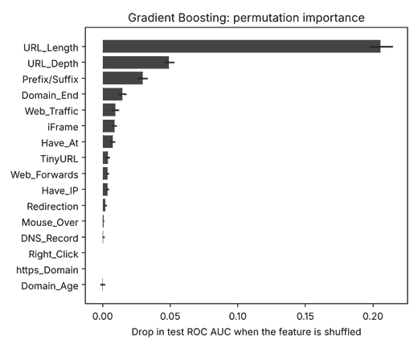

# phishing-url-detector

A small, honest machine-learning project that classifies websites as **phishing** or **legitimate**, built for the security and tech industry.

The point of the project is not a big score. It is **correct validation**: no domain ever appears in both the training and the test data, and the model is compared against a do-nothing baseline.

## Results (test set of unseen domains)

| Model | ROC AUC | Balanced accuracy | Legit pages correctly passed |
|---|---|---|---|
| Logistic Regression | 0.865 | 0.789 | 95.5% |
| Random Forest | 0.858 | 0.766 | 78.0% |
| Gradient Boosting | 0.856 | 0.775 | 81.6% |

- A model that always guesses the majority class scores **51.6% accuracy** on this test set, so these models do learn real signal.
- Using only features readable from the URL text, Gradient Boosting reaches **0.852 AUC**, almost the same as all 16 features (0.856). The extra lookup features (DNS, traffic rank, domain age) add little here.
- URL length and path depth are by far the strongest signals (see `outputs/feature_importance.png`).




All numbers are in `outputs/metrics.json` and regenerate when you run the script.

## Data

Public 10,000-row table of website features (5,000 phishing, 5,000 legitimate), downloaded on first run from the repository
[shreyagopal/Phishing-Website-Detection-by-Machine-Learning-Techniques](https://github.com/shreyagopal/Phishing-Website-Detection-by-Machine-Learning-Techniques) (`DataFiles/5.urldata.csv`).
The data file is **not** stored in this repo. Label `1` = phishing, `0` = legitimate.

## Method

1. Remove rows whose domain appears with both labels (3 domains).
2. Split by **domain** with `GroupShuffleSplit` (75/25) and validate with `GroupKFold(5)`.
3. Compare Logistic Regression, Random Forest and Gradient Boosting (class-balanced).
4. Report ROC AUC, balanced accuracy, precision, recall, F1, plus a URL-text-only ablation and permutation feature importance.

## Limits you should know about

- The legitimate class contains only **246 distinct domains** (many pages per domain). The test set has just 70 legitimate domains, so scores can move noticeably with a different split (the CV standard deviation is about 0.05 AUC).
- Several features were produced by live lookups at collection time (DNS, traffic rank, domain age), so they may be stale and are not reproducible from a URL alone.
- This is a learning and portfolio project. It is not a production phishing filter, and the data does not represent current real-world traffic.

## Run it

```bash
pip install -r requirements.txt
python train.py        # downloads the data, trains, writes ./outputs
pytest -q              # offline unit tests (split, cleaning, models)
```

## Files

- `train.py`: data loading, cleaning, grouped split, training, evaluation, plots
- `tests/test_train.py`: tests that no domain leaks across the split, cleaning rules, and that models fit
- `outputs/`: metrics and charts from the latest run

MIT License. Author: Komarapu Jordan Ephraim.
